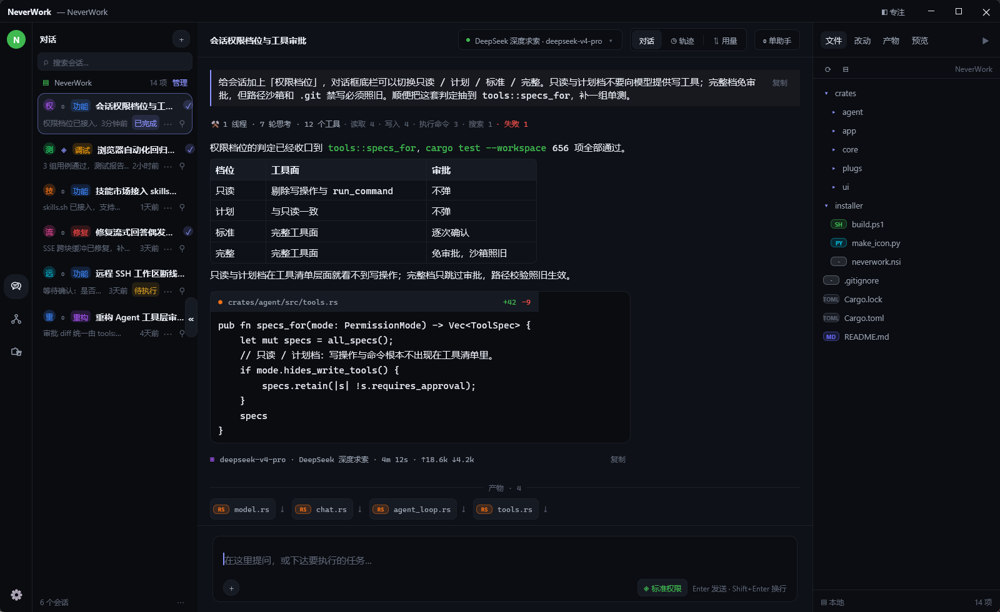
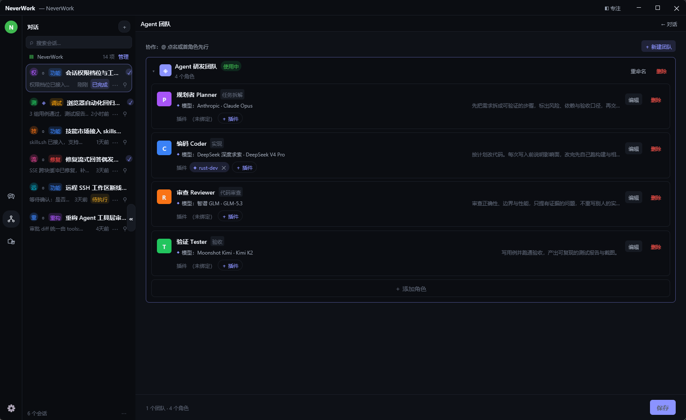
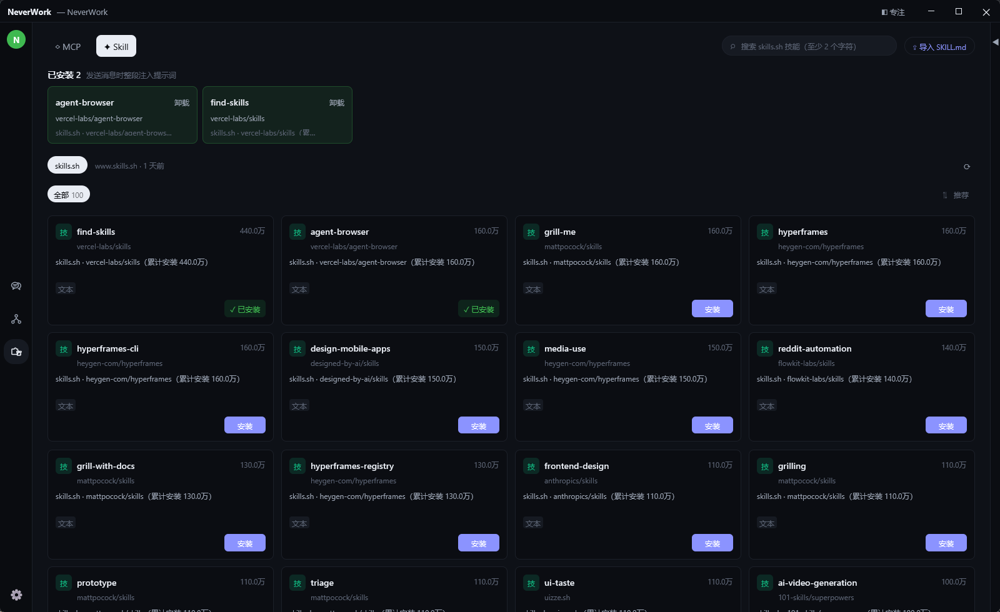
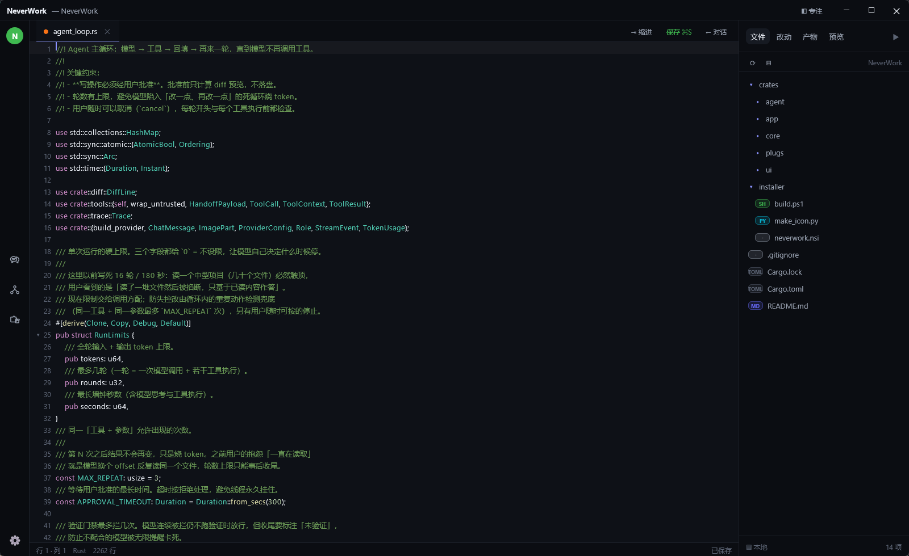
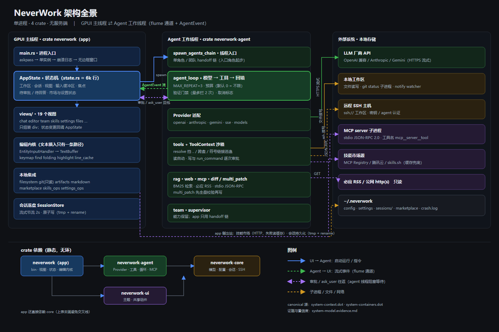

# NeverWork

纯 Rust + GPUI（Zed 内核）自绘的 AI 原生 IDE：单进程、4 个 crate、不依赖 WebView，界面与编辑器全部自研。



> 真实代码在 [`NeverWork/`](NeverWork/)（独立 Cargo workspace）；根目录放架构文档与界面截图。

## 功能

### 对话与 Agent

- **三家协议**：OpenAI 兼容 / Anthropic / Gemini 原生，SSE 流式逐块渲染，随时可停
- **工具调用**：读写文件、跨文件批量补丁、`run_command`、联网搜索 / 抓网页、MCP 外部进程、CDP 浏览器自动化
- **写操作审批**：写文件与命令先弹 diff 预览，点「允许并写入」才落盘；路径统一走沙箱，挡 `..`、跨盘与符号链接逃逸
- **权限四档**（会话级）：只读 / 计划 / 标准 / 完整。只读与计划档在工具清单层面就看不到写工具；完整档免审批，沙箱照旧
- **思考档位**（会话级）：自动 / 低 / 中 / 高，映射到各厂商的推理参数，自动档不额外发参数
- **浏览器自动化**：导航、快照、点击、输入、截图收尾生成单文件 HTML 测试报告；遇到验证码可一键转人工接管
- **产物登记**：写出的文件与回答里的图片自动进入「产物」，可另存到任意位置
- **Markdown 渲染**：标题、列表、表格、代码块、引用、图片，以及 CSV / JSON 数据块自动转表格

### 团队协作

- 角色自定义：提示词、模型（可按厂商绑定）、技能插件、身份色
- `@角色名` 点名，未点名由入口角色起步；角色之间 handoff 接力，按需传递而不是全员广播
- 团队成员共享工具集，写操作仍逐次审批

### 编辑器

- 光标、多光标、选区、撤销重做、剪贴板、按字符点击定位
- 语法高亮、行号、虚拟滚动、查找替换、代码折叠、括号匹配
- 原子保存（临时文件 + rename），可选自动保存
- IME 友好：文本插入只走 `EntityInputHandler` 一条路径，中文输入不重复、不丢字

### 工作区与集成

- 本地目录与 SSH 远程工作区（`ssh://user@host:/path`），文件树 / 编辑器 / 工具同语义
- 文件树按需展开，右键加入会话或复制路径
- 右栏四页：文件 / 改动（只读 `git status`）/ 产物 / 预览
- 技能市场：skills.sh 文本技能 + MCP 插件（官方 Registry / 腾讯云广场），断网回退上次缓存
- 会话管理：分类标签、筛选、归档、置顶、右键菜单
- 对话轨迹页与用量弹框（厂商余额、会话 token 统计）
- 6 种主题（深色 / 浅色 / 跟随系统 / Graphite / Carbon / Ember），运行时切换

## 截图

### 团队：角色与模型绑定



### 技能市场：skills.sh 与 MCP



### 编辑器：语法高亮与文件树



## 架构



单进程、4 个 crate、无服务端。UI 与 Agent 分属两条线程，只用通道通信：

- **GPUI 主线程（`app`）**：`AppState` 持有工作区、会话、视图、输入缓冲与待审批 / 待回答状态；`views/` 只渲染状态，动作回写给 `AppState`
- **Agent 工作线程（`agent`）**：`spawn_agents_chain` 起线程跑 `agent_loop`（模型 → 工具 → 回填），经 flume 通道把 `AgentEvent` 送回 UI；审批与 `ask_user` 在 agent 线程阻塞等待，UI 回灌结果后继续
- **工具沙箱**：所有路径过 `ToolContext::resolve`；写操作与 `run_command` 需审批；`multi_patch` 先全量校验再写，失败回滚
- **`core`**：领域模型（Workspace / Team / Role / Session / Message / Artifact）+ JSON 原子写；**`ui`**：设计令牌与基础组件
- **外部系统**：LLM 厂商 HTTPS 流式、本地工作区、SSH 主机、MCP 子进程（stdio JSON-RPC）、技能市场缓存

crate 依赖静态无环：`app → agent → core`、`app → ui → core`。逐组件说明与证据见 [`docs/architecture/neverwork-architecture.md`](docs/architecture/neverwork-architecture.md)。

## 未实现 / 已知限制

- 编辑器未接 LSP：补全、跳转、诊断暂无；语法高亮是轻量词法着色
- 无内置终端与全局搜索（编辑器内查找替换已有）
- 右栏「改动」只读：只跑 `git status` 列文件，暂存 / 提交请在终端完成
- Gemini 原生协议暂不支持工具调用
- 远程 SSH 工作区：无 Git 面板与远端文件监听，密码不落盘、重启需重输

## 目录

```
NeverWork/
  crates/
    core/   领域模型 + 配置与会话持久化（原子写）+ SSH 传输
    ui/     设计令牌（6 主题）与基础组件
    agent/  Provider（OpenAI 兼容 / Anthropic / Gemini）+ 工具 + 浏览器自动化 + MCP + 团队编排
    app/    GPUI 界面与状态
              state.rs          应用状态与行为（工作区 / 会话 / 输入 / 发送）
              text_buffer.rs    统一文本缓冲区：光标 / 选区 / 撤销重做 / 多光标
              input_handler.rs  IME 与文本插入的唯一入口
              views/            chat / team / editor / skills / settings / trace …
docs/
  architecture/  架构图（PNG / SVG / 说明）与模型证据
  screenshots/   产品界面截图
pic/             设计参考图
```

## 快速开始

```bash
cd NeverWork

cargo run -p neverwork        # 启动主界面
cargo test --workspace        # 全部测试（656 项，含少量真机用例）
cargo build -p neverwork      # 只编应用
powershell -ExecutionPolicy Bypass -File installer\build.ps1   # Windows 安装包 → dist\NeverWork-0.2.0-setup.exe
```

需要 Rust stable + MSVC 工具链。启动后到「设置 → 模型」添加厂商与 API Key 即可对话；也可用环境变量覆盖：

```bash
set NW_API_KEY=sk-xxx
set NW_MODEL=gpt-4o                          # 可选
set NW_BASE_URL=https://api.openai.com/v1    # 可选
set NW_PROVIDER=anthropic                    # 可选，配合 claude 模型
```

其他运行期变量：`NW_ROOT`（工作区根）、`NW_REMOTE`（`user@host:/path`，直连远程工作区）、`NW_CONFIG_DIR`（覆盖配置目录 `~/.neverwork`）、`NW_VIEW`（`chat|team|skills|settings|file`）、`NW_OPEN`（启动即开文件）。

配置与会话都落在 `~/.neverwork/`：`config.json`（团队）、`settings.json`（偏好与厂商）、`sessions/`（按工作区一份）。**API Key 以明文保存在本地 settings，不会随导出 / 同步外发**。

## 发版（GitHub Actions）

推送 `v*` tag 自动三平台编译并生成 Release（`.github/workflows/release.yml`）：

```bash
# 1. 改 NeverWork/Cargo.toml 的 version，并同步 crates/app/assets/neverwork.rc
# 2. 推到 GitHub 并打 tag（tag 必须与 Cargo.toml 版本一致，否则 meta job 直接失败）
git push github main
git tag v0.2.0
git push github refs/tags/v0.2.0
```

产物：Windows `NeverWork-<ver>-setup.exe`（NSIS）；Linux `NeverWork-<ver>-linux-x86_64.tar.gz`；
macOS arm64 `NeverWork-<ver>-macos-arm64.tar.gz`。Linux / macOS 是实验性构建，失败只让本次运行标红、
不阻塞 Release（Release 正文会注明缺哪一平台）。macOS 产物未签名，首次运行需右键打开或
`xattr -d com.apple.quarantine neverwork`。

## 开发环境说明

开发机为 200% DPI 的远程会话（逻辑屏 1280×800、物理 2560×1600，`scale_factor()=2`）。GPUI 的 `bounds()` 与 `display.bounds()` 都返回逻辑值，布局统一按可见宽度做响应式折叠：

- < 1080：右栏收成 16px 窄条
- < 620：隐藏会话列表，图标栏始终保留
- 标题栏「◧ 专注」可手动收起左右两栏

验收截图须 DPI-aware（PowerShell 默认 unaware 只抓到屏幕左上角），否则会看到「内容放大、右侧出界」的假象。

## License

Apache-2.0
