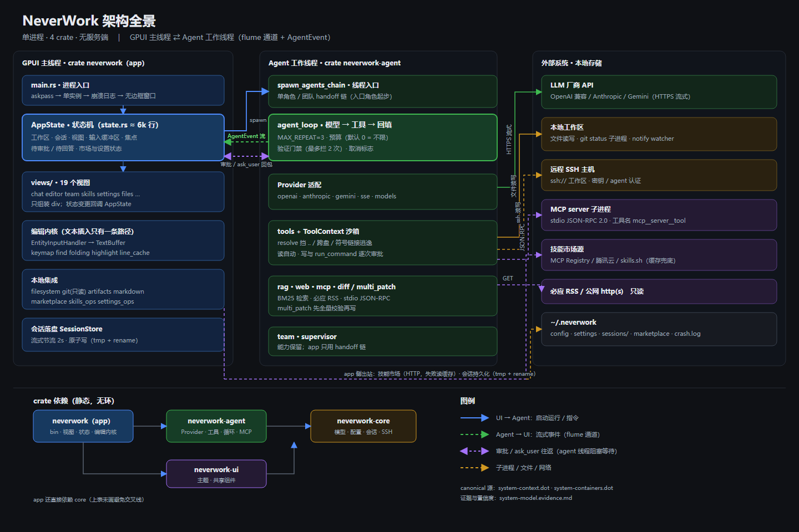

# NeverWork 当前架构（L1–L3）

> 范围：`NeverWork/` workspace 的**当前状态**（不做目标态规划、不做风险评审）。
> 方法：`system-modeler` + `graphviz`（canonical 源）；SVG 为导出的阅读版。
> 证据：见 [system-model.evidence.md](system-model.evidence.md)。
> 图：[neverwork-architecture.svg](neverwork-architecture.svg)（全景，canonical）· [neverwork-architecture.png](neverwork-architecture.png)（导出）
> 源：[system-context.dot](system-context.dot) · [system-containers.dot](system-containers.dot)



## 一句话

NeverWork 是一个**单进程、无服务端的 Windows 桌面 IDE**：GPUI 负责渲染与状态（主线程），
Agent 在独立阻塞线程里跑「模型 → 工具 → 回填」循环，两者只通过 **flume 通道 + 事件枚举**通信；
领域模型与持久化收敛在 `neverwork-core`，LLM/工具/编排收敛在 `neverwork-agent`。

## L1 系统上下文

| 元素 | 形态 | 证据 |
| --- | --- | --- |
| 本地用户 | Windows 桌面键鼠 + 输入法 | `main.rs`、`input_handler.rs` |
| NeverWork.exe | 单进程；单实例互斥量；无 HTTP 服务端 | `main.rs::single_instance` |
| LLM 厂商 | OpenAI 兼容 / Anthropic / Gemini，HTTPS 流式 | `agent/src/{openai,anthropic,gemini}.rs` |
| 本地工作区 | 直接文件读写；`git status` 子进程；`notify` watcher | `app/src/{filesystem,git}.rs`、`state.rs` |
| 远程 SSH 主机 | `ssh://` 工作区；文件与命令都经 ssh 子进程 | `core/src/ssh.rs`、`agent/src/tools.rs` |
| MCP server | 本机子进程，stdio JSON-RPC 2.0 | `agent/src/mcp.rs` |
| 技能市场源 | MCP 官方 Registry / 腾讯云广场 / skills.sh | `app/src/marketplace.rs` |
| 联网工具 | 必应 RSS + 公网 http(s)（只读、不审批） | `agent/src/web.rs` |
| 本地存储 | `~/.neverwork/`：config / settings / sessions / marketplace | `core/src/{config,settings,sessions}.rs` |

**边界**：应用没有后端服务、没有数据库、没有账号体系；所有状态是「本机文件 + 内存」。
唯一的跨机能力是 SSH 工作区（命令都由本机 `ssh` 发起）。

## L2 容器：4 个 crate，依赖无环

```
app (bin neverwork)  ──┬──> core
   │                   ├──> ui  ──> core
   └──> agent ─────────┘
```

| crate | 职责 | 关键约束 |
| --- | --- | --- |
| `neverwork-core` | 领域模型、配置/会话持久化、SSH 协议封装 | **零 UI 依赖**；纯数据 + 文件 IO |
| `neverwork-ui` | 主题（9 套色板）与共享组件 | 只依赖 core |
| `neverwork-agent` | Provider 适配、Agent 循环、工具、MCP、RAG、web、diff、团队交接 | 不依赖 gpui；阻塞 `ureq` |
| `neverwork`（app） | 进程入口、AppState、19 个视图、编辑器内核、本地集成 | 唯一持有 UI 线程 |

按行数看重心（证据：源码统计）：

- `app/src/state.rs` ≈ 6.0k 行 —— 状态机事实上的「中枢」
- `app/src/views/chat.rs` ≈ 3.1k；`agent/src/tools.rs` ≈ 2.3k；`app/src/views/team.rs` ≈ 1.8k
- `agent/src/agent_loop.rs` ≈ 1.9k；`app/src/settings_ops.rs` ≈ 1.6k；`app/src/marketplace.rs` ≈ 1.5k

## L3 组件：两侧各自的内部结构

**app（UI 侧）**

- `main.rs`：askpass 端点 → 单实例 → 日志/崩溃钩子 → 无边框窗口。
- `state.rs`：`AppState` 持有工作区、会话、视图枚举、输入缓冲、焦点、待审批/待回答、市场与设置状态；
  所有「状态怎么变」在这里，`views/` 只负责组装 `div`。
- 编辑内核：`EntityInputHandler → TextBuffer` 是**唯一文本插入路径**；`keymap.rs` 只处理非文本键；
  `line_cache/folding/find/highlight/brackets` 是编辑器的横向能力。
- 本地集成：`filesystem`（树）、`git`（只读 status）、`artifacts`（产物解析/导出）、
  `markdown`（对话渲染子集）、`marketplace` + `skills_*`、`settings_ops`。

**agent（执行侧）**

- `agent_loop`：单轮 = 一次模型调用 + 若干工具执行；内建 `MAX_REPEAT=3`、验证门禁（最多拦 2 次）、
  预算（默认 0=不限）、取消标志、`NeedApproval`/`AskUser` 阻塞点。
- `tools`：`ToolContext` 是唯一路径入口（`resolve` 挡 `..`、跨盘、符号链接逃逸）；
  写操作与 `run_command` 一律 `requires_approval = true`；远程工作区把后端换成 `RemoteFs`。
- `openai/anthropic/gemini + sse`：统一 `LlmProvider` trait → `StreamEvent`。
- `mcp`：stdio JSON-RPC；工具名 `mcp__<server>__<tool>`；所有 MCP 工具按写操作审批。
- `rag`：BM25 分块检索，`search_code` 的实现；无 embedding、每次调用重建索引。
- `web`：必应 RSS 搜索 + HTML→纯文本抓取；只读、默认常开。
- `diff/multi_patch`：写前 diff 预览；`multi_patch` 先全量校验再写。
- `team/supervisor`：编排能力仍在，**app 只使用 handoff 链**（入口角色起步）。

## 运行时模型（关键）

```
GPUI 主线程                          Agent 工作线程（std::thread）
AppState ──spawn(run_agent)──▶  agent_loop ──▶ Provider(ureq 阻塞流式)
   ▲                                  │
   │   flume AgentEvent（TextDelta、    │ 工具执行（ToolContext）
   │   ToolStarted、ToolFinished …）    │
   └──────────────────────────────────┘
        NeedApproval / AskUser：agent 线程阻塞，UI 回包后才继续
```

- **通道**：`flume::unbounded<(usize, AgentEvent)>` 回 UI；审批/问答用**内嵌的 bounded Sender** 反向回包，
  agent 线程在 200ms 轮询取消、300s 超时。
- **UI 消费**：`cx.spawn(async)` 里 `rx.recv_async().await`，再用 `weak.update` 回主线程改状态；
  每个 delta 触发 `cx.notify()`，会话落盘按 2s 节流。
- **远程文件 IO**：`std::thread` + `flume::bounded(1)` + **代次（gen）**丢弃迟到结果；
  `remote_gen/remote_conn_gen/remote_open_gen` 分别管树、连接、打开文件。
- **MCP**：子进程 + 独立读线程 + `recv_timeout`，避免 server 挂住拖死整轮。
- **取消**：`Arc<AtomicBool>`，每轮开头与每个工具前检查。

## 关键流程

**1）一次对话**

`TextBuffer` → `AppState::send` → `spawn_agents_chain`（线程）→ `run_agent` / `run_agent_in_team`
→ Provider 流式 → `AgentEvent` 回 UI → 追加到消息气泡 → 节流落盘。

**2）写操作审批回路**

`ToolStarted(preview)` → `NeedApproval(respond)` → UI 渲染 diff 卡片 → 用户允许/拒绝
→ `respond.send(bool)` → agent 线程继续 → `ToolFinished` → 结果与调用一起回放给模型。

**3）团队**

`@角色名` 点名 → 否则 `roles[0]` 入口；开工具走 handoff 链（入口角色带 `handoff` 工具按需接力）；
关工具只跑入口角色（纯文本，工具历史压平）。

**4）远程工作区**

连接串 `ssh://[user@]host[:port]/abs/path` → `RemoteFs` → 树/读/写/工具全部走 ssh；
密码只在内存，经 `SSH_ASKPASS` 回调应用自身，不落盘、不进命令行。

## 数据与持久化

| 文件 | 内容 | 写入方式 |
| --- | --- | --- |
| `~/.neverwork/config.json` | 团队与当前团队 | 临时文件 + rename |
| `~/.neverwork/settings.json` | 偏好、厂商、模型、技能、MCP（**含 Key 明文**） | 同上 |
| `~/.neverwork/sessions/<slug>-<hash>.json` | 每工作区一个会话库 | 同上；流式期间 2s 节流 |
| `~/.neverwork/marketplace.json` | 市场热榜缓存（10 分钟内不重拉） | 同上 |
| `~/.neverwork/artifacts/` | data URI 图片解码、产物导出 | 内容哈希幂等 |
| `~/.neverwork/crash.log` | panic + backtrace | 追加 |

## 扩展点（现状）

1. **新增 Provider**：实现 `LlmProvider`，在 `build_provider` 注册；`list_models` 按协议拉模型。
2. **新增内置工具**：在 `tools.rs` 定义 `ToolSpec` + 执行分支；写类需 `requires_approval`。
3. **新增 MCP**：配置 `McpServerConfig` 自动接入 `mcp__*`；审批策略固定为「按写操作」。
4. **新增视图**：`CenterView` 加枚举 + `views/` 加文件 + `center_area` 分派。
5. **新增主题**：`ui/theme.rs` 的 `PALETTES` 加一整套色板（禁止视图写死颜色）。

## 结构性观察（客观描述，非评审报告）

- **分层清晰但 app 偏重**：core 无 UI 依赖、agent 无 gpui 依赖，边界守得住；
  代价是 `AppState` + `state.rs` 承载了大多数交互状态，视图与状态耦合集中在单文件。
- **同步 IO + 线程 + 通道**是贯穿全项目的一致风格：Provider、远程文件、MCP、市场请求都是
  「后台线程 + flume + 代次/超时」，没有引入 async 运行时。
- **安全边界是「路径沙箱 + 逐次审批 + 权限档位」三段式**：`read_only/plan` 直接剔除写工具，
  `standard` 逐次审批，`full` 只免审批、不免沙箱与超时。
- **验证门禁由机制判定**（代码后缀 + 构建命令关键词），不交给模型自觉；文档类改动不拦。
- **团队编排**保留了两套能力（handoff 链与 `run_team`），UI 只用前者——存在未使用的编排代码路径
  （属结构事实，是否需要清理需另做决策）。

## 验证缺口（unknowns）

- `agent/src/team.rs` + `supervisor.rs` 的并行/主管指派路径**无 UI 调用**，其运行时正确性缺证据。
- Gemini 的工具调用未接（`GeminiProvider` 目前只做纯文本流），属于能力缺口而非架构缺口。
- 无 LSP / tree-sitter / 终端 / 全局搜索；编辑器语义能力靠自研高亮与折叠。
- 本报告未做性能与并发压测，线程模型结论来自代码结构，不是运行时观测。